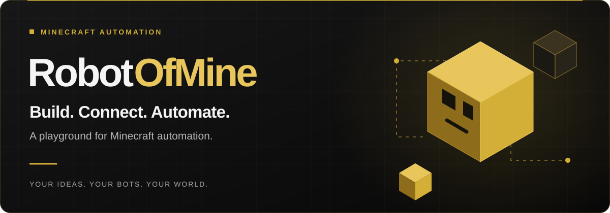

  

  Build visual routines for Minecraft Java bots, 
  connect them to a server, and watch them work in your browser.

  
  
  

 

## Small routines. Big possibilities.

<table>
<tr>
<td width="50%" valign="top">

### 🧩 Build visually

Connect triggers, actions, conditions, and loops. Turn gathering, crafting, and farming into routines of your own.

</td>
<td width="50%" valign="top">

### 🧭 Stay in control

Watch your bots in a live 3D viewer or 2D map. Manage inventory and follow their recent activity.

</td>
</tr>
<tr>
<td width="50%" valign="top">

### ✨ Make room for AI

Add AI actions and decisions where useful. Prefer to build without AI? That works too.

</td>
<td width="50%" valign="top">

### 🔌 Bring your tools

Send bot commands through the Public API, or connect a compatible AI client through MCP.

[Explore integrations →](https://docs.robotofmine.com/integrations)

</td>
</tr>
</table>

## One idea. A bot that follows through.

A chat message can set a whole routine in motion:

> 💬 **Chat message** → 🪵 **Gather logs** → 🛠️ **Craft planks** → 📦 **Store in a chest**

Build it in the visual editor, connect your bot, and watch it run.

 

  <strong>What will you build?</strong> 
  Get help, swap ideas, and share your experiments.  
  <a href="https://discord.robotofmine.com"><strong>Meet the community →</strong></a>

